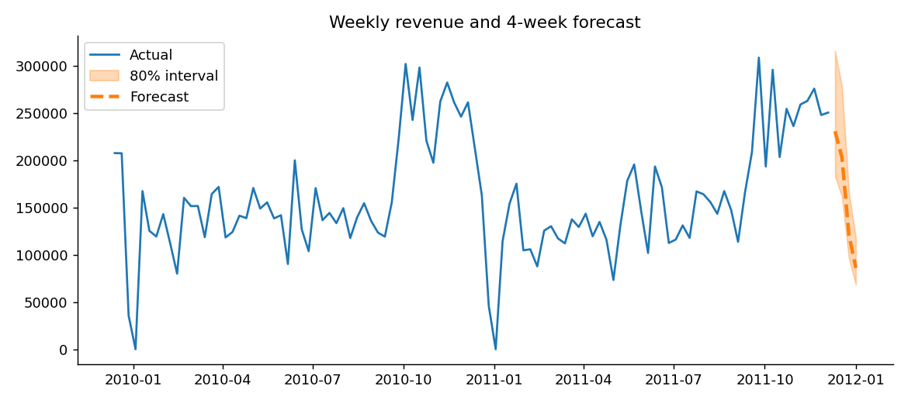
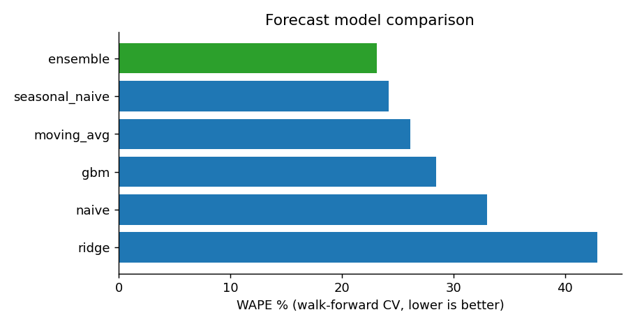
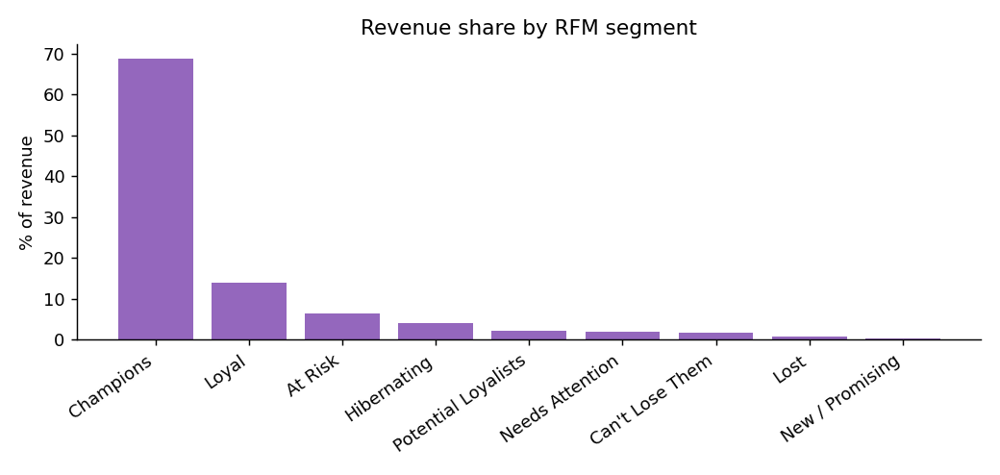
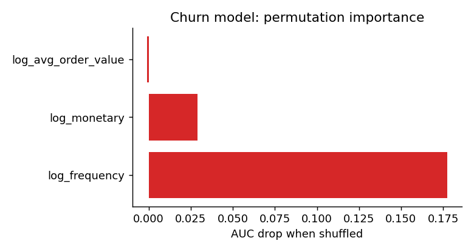
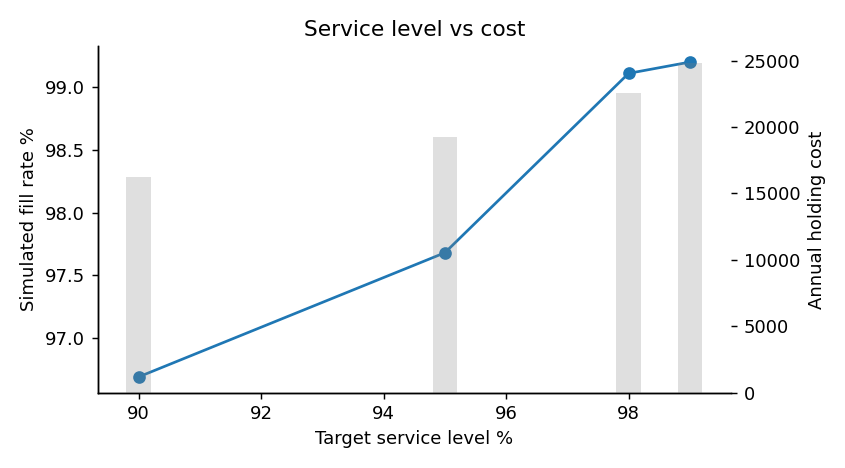

# RetailPulse v2 — Final Report

**Project:** AI-Powered Customer Analytics & Demand Forecasting (Zidio) · **Release:** 2.0.0 (Week 4)
**Author:** _your name_ · **Dates:** _fill in_ · **Code:** _GitHub link_ · **Live app:** _Streamlit link_

## 1. Objective
Help a retailer (1) forecast demand, (2) understand customers, (3) find customers drifting away,
(4) plan inventory to avoid stockouts and overstock, and (5) monitor the models in production.

## 2. Data
Online Retail II (UCI): 2 years of transactions, 5,878 customers with purchases, 739 trading days,
total revenue £17.37M. Cleaning rules (automated in `data.clean_transactions`): remove duplicates,
cancellations (invoices starting with C), missing customer IDs, non-positive quantity/price and
non-product stock codes (postage, fees, adjustments).

## 3. Method and results

### 3.1 Demand forecasting
Weekly revenue (full Mon–Sun weeks only) is forecast with five models; the ensemble weights the
three best by inverse squared CV error. Validation is **walk-forward** (train on ≥ 52 weeks, predict
4 weeks, roll forward 4 weeks, 13 folds) so no model sees the future.

| Model | WAPE % | MAPE % | MAE |
|---|---|---|---|
| **Ensemble** | **23.1** | 27.1 | 37,040 |
| Seasonal naive (52 w) | 24.2 | 28.3 | 38,750 |
| Moving average (4 w) | 26.1 | 29.7 | 41,862 |
| Gradient boosting (lags + Fourier) | 28.4 | 33.9 | 45,542 |
| Naive (last week) | 33.0 | 37.9 | 52,917 |
| Ridge (lags + Fourier) | 42.9 | 45.7 | 68,741 |

Next 4 weeks (w/e 11 Dec 2011 → 1 Jan 2012): £231k, £203k, £122k, £86k — the decline reflects the
Christmas shutdown seen the previous year. 80 % intervals were calibrated on CV errors (empirical
coverage 77 %). *The prototype reported 3.65 % MAPE on a 5-week hold-out; that figure came from a
tiny, lucky window and is not comparable to cross-validated error.*

### 3.2 Customer segmentation
RFM quintile scores give 9 business segments; K-Means on log-scaled RFM (k chosen by silhouette,
k = 4, 0.36) gives data-driven clusters. **Champions are 22 % of customers but 69 % of revenue.**
"At Risk" and "Can't Lose Them" (446 customers, £1.4M historical revenue) are the best win-back targets.

### 3.3 Churn / lapse
Lapsed = no purchase in 90+ days (51 % of customers). The prototype's AUC of 1.00 was **label
leakage** (the label is a threshold on recency and recency was an input). v2 removes recency and
learns from frequency, spend and basket value: **AUC 0.77 (hold-out), 0.76 (5-fold CV), recall 0.74.**
Frequency dominates importance. The model scores *active* customers: 397 are high-risk and 1,085
medium-risk; the top-100 win-back list carries £663k of expected revenue at risk.

### 3.4 Inventory optimisation
Units demanded per day: mean 14.2k, σ 12.6k. At 95 % service and a 7-day lead time: EOQ 45.8k
units, safety stock 54.6k, reorder point 154k. An (s, Q) simulation over the 739 days gives a
**97.7 % fill rate** (13 stockout days of 604 trading days).

| Service level | Safety stock | Annual holding cost | Fill rate | Stockout days |
|---|---|---|---|---|
| 90 % | 42,570 | £16,225 | 96.7 % | 23 |
| 95 % | 54,638 | £19,217 | 97.7 % | 13 |
| 98 % | 68,221 | £22,583 | 99.1 % | 6 |
| 99 % | 77,276 | £24,828 | 99.2 % | 4 |

### 3.5 Monitoring
PSI and KS tests compare the last 180 days with history: revenue (PSI 0.22), units (0.30) and
orders (0.20) all shifted upward — consistent with year-over-year growth, so this is flagged as
*informational*. Model-performance drift (recent vs baseline WAPE) is 13.8 % vs 23.1 %, so no
retraining is recommended. Every pipeline run is appended to `run_history.jsonl` (and MLflow if enabled).

## 4. System
Streamlit dashboard (6 pages) and FastAPI service share one service layer; the Docker image trains
at build time and exposes health checks; GitHub Actions runs ruff, pytest, an API smoke test and a
Docker build. 25 automated tests cover cleaning, CV look-ahead, leakage, simulation conservation,
drift maths and API contracts.

## 5. Challenges and fixes
| Challenge | Solution |
|---|---|
| Partial final week looked like a sales collapse | Drop incomplete edge weeks |
| Perfect churn AUC | Found leakage; removed recency from features, added a guard test |
| Unrealistic validation | Walk-forward CV, WAPE (robust to near-zero days) |
| Orders re-placed every day in simulation | Use inventory position (on-hand + on-order) |
| Mixed date formats in raw files | Robust parsing in the cleaning step |

## 6. Limitations and next steps
Short history (one prior Christmas); aggregate-level inventory; inactivity-based churn definition.
Next: SKU-level forecasting, promotions/holiday regressors, real-time ingestion, scheduled retraining
(Airflow/cron) driven by the retrain flag, recommendation engine.

## 7. Conclusion
RetailPulse v2 delivers a validated forecast (23 % WAPE vs 33 % for the naive baseline), actionable
customer lists, a quantified inventory policy and monitoring — packaged, tested and deployable.
